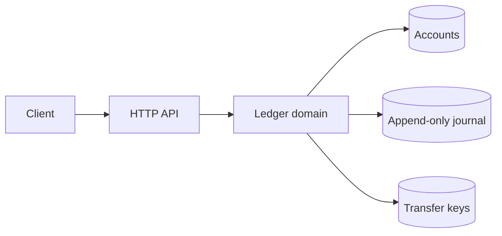

# Aurora Ledger

[](https://github.com/borikhan/aurora-ledger/actions/workflows/ci.yml)
[](https://go.dev/)

A production-minded double-entry ledger API built as a Go modular monolith. Aurora emphasizes the invariants that financial software cannot negotiate: every transfer balances to zero, money uses integer minor units, commands are idempotent, and concurrent access is race-safe.

## Engineering highlights

- Atomic, currency-safe transfers with deterministic idempotency keys
- Append-only debit and credit entries plus an explicit audit invariant
- Concurrent access protected by a small, testable domain boundary
- Dependency-free HTTP transport, structured logs, health checks, and config from the environment
- Multi-stage, non-root container and least-privilege CI permissions



## Run it

```bash
go run ./cmd/api
go test -race ./...
docker build -t aurora-ledger .
```

Configuration is documented in [`.env.example`](.env.example). Create accounts with `POST /v1/accounts`, transfer value with `POST /v1/transfers`, and inspect an account with `GET /v1/accounts/{id}`.

## Design scope

The included in-memory repository keeps the core executable without infrastructure. A production deployment would implement the same atomic boundary in PostgreSQL using serializable transactions and a unique constraint on transfer IDs. This distinction is intentional and documented rather than hidden.

See [architecture and operational design](docs/architecture.md) for scaling, failure modes, and the complete twelve-factor mapping.

## License

MIT
